# 医院核酸检测预约挂号微信小程序--论文

> 🎓 **计算机毕业设计 · 医院核酸检测预约挂号微信小程序--论文**
>
> 本仓库只放**项目介绍 + 运行截图**（截图是站点带水印的原图，存在仓库 `images/` 里）。
>
> 👉 **完整可运行源码 / 数据库脚本 / 部署文档：[点我获取](https://geekcode.top/archives/%E5%8C%BB%E9%99%A2%E6%A0%B8%E9%85%B8%E6%A3%80%E6%B5%8B%E9%A2%84%E7%BA%A6%E6%8C%82%E5%8F%B7%E5%BE%AE%E4%BF%A1%E5%B0%8F%E7%A8%8B%E5%BA%8F-%E8%AE%BA%E6%96%87?utm_source=github)**
>
> 💬 咨询微信：**ir9372**　|　🌐 更多项目：[极客代码 geekcode.top](https://geekcode.top/?utm_source=github)
>
> 📌 项目详情页：<https://geekcode.top/archives/%E5%8C%BB%E9%99%A2%E6%A0%B8%E9%85%B8%E6%A3%80%E6%B5%8B%E9%A2%84%E7%BA%A6%E6%8C%82%E5%8F%B7%E5%BE%AE%E4%BF%A1%E5%B0%8F%E7%A8%8B%E5%BA%8F-%E8%AE%BA%E6%96%87?utm_source=github>

<table><td width="230" align="center"> <b>扫码加微信 ir9372</b></td><td valign="middle">📦 源码 = 项目介绍 + 全部运行截图 + 数据库 + 部署文档 👉 点上方任意截图，直接跳到 <b>极客代码 geekcode.top</b> 详情页</td></table>

---

<h1>医院核酸检测预约挂号微信小程序--论文</h1>
<h2>项目概述</h2>

本项目旨在开发一套基于微信小程序与 Java 后端的医院核酸检测预约挂号系统，以解决传统线下排队检测效率低、信息不对称及预约流程繁琐的问题。系统核心功能涵盖用户在线注册登录、查看医院信息与公告、浏览核酸检测服务详情、选择预约时间段进行下单支付、查询核酸报告以及在线咨询等全流程业务。适用人群包括需要办理核酸检测的普通市民（小程序端）以及负责运营维护的管理员（Web 后台端）。技术架构采用前后端分离模式，前端使用微信小程序原生框架结合 Vue 集成方案，后端基于 Spring Boot 构建 RESTful API，利用 MyBatis-Plus 进行数据持久化，Shiro 实现权限控制，MySQL 存储业务数据，确保系统的高可用性与扩展性。

<h2>技术架构</h2>

本系统采用经典的前后端分离架构，通过 HTTP/HTTPS 协议下的 REST API 进行数据交互。

<strong>后端架构：</strong>
后端服务基于 Java 语言开发，核心框架选用 <strong>Spring Boot</strong>，利用其自动配置特性快速搭建应用骨架。持久层采用 <strong>MyBatis-Plus</strong>，在 MyBatis 的基础上增强 CRUD 操作能力，简化 SQL 编写并提高开发效率。数据库选用 <strong>MySQL</strong>，用于存储用户信息、医院数据、预约记录及检测报告等业务数据。安全模块引入 <strong>Apache Shiro</strong>，负责身份认证与授权管理，确保接口访问的安全性。此外，集成 <code>spring-boot-starter-web</code> 处理 Web 请求，<code>commons-lang3</code> 提供通用工具类支持。

<strong>前端架构：</strong>
前端分为两个部分：

<ol>
<li><strong>微信小程序端</strong>：面向普通用户和管理员移动办公场景。通过 <code>wx.request</code> 调用后端 REST API，实现页面渲染与数据绑定。界面包含首页、核酸检测列表、预约详情、个人中心及后台管理入口等模块。</li>
<li><strong>Web 管理后台</strong>：面向管理员进行全量数据管理。虽然具体前端框架未在依赖中显式列出 Vue CLI 版本，但根据“vue-integrated”类型及常见毕设实践，推测采用 Vue.js 生态构建单页应用（SPA），通过 Axios 或类似库与后端通信。</li>
</ol>

<strong>交互方式：</strong>
小程序与后端之间遵循标准的 JSON 数据格式传输。前端发起 GET/POST/PUT/DELETE 请求，后端 Controller 接收参数，经 Service 层逻辑处理后，由 Mapper 层操作数据库，最终返回统一格式的响应结果。

<a href="https://geekcode.top/archives/%E5%8C%BB%E9%99%A2%E6%A0%B8%E9%85%B8%E6%A3%80%E6%B5%8B%E9%A2%84%E7%BA%A6%E6%8C%82%E5%8F%B7%E5%BE%AE%E4%BF%A1%E5%B0%8F%E7%A8%8B%E5%BA%8F-%E8%AE%BA%E6%96%87?utm_source=github" title="查看完整源码">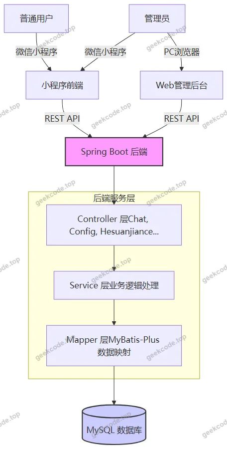</a>

<h2>功能模块</h2>

根据代码上下文中的 Controller 列表、路由配置及截图展示的功能，系统将分为小程序用户端、小程序管理端和 Web 后台管理端三个主要部分。

<h3>1. 小程序用户端</h3>

此端面向普通就诊者，提供便捷的移动端服务入口。

<ul>
<li><strong>账户体系</strong>：</li>
<li><strong>登录/注册</strong>：支持用户手机号或账号密码注册与登录。</li>
<li><strong>忘记密码</strong>：提供密码找回功能。</li>
<li><strong>个人信息</strong>：用户可编辑个人资料，查看当前登录状态。</li>
<li><strong>资讯与服务</strong>：</li>
<li><strong>首页</strong>：展示系统概览及快捷入口。</li>
<li><strong>公告信息</strong>：查看医院发布的最新通知（对应 <code>/news</code> 路由及 <code>NewsController</code>）。</li>
<li><strong>医院信息</strong>：浏览各医院的详细介绍、地址及联系方式（对应 <code>/yiyuanxinxi</code> 路由及 <code>YiyuanxinxiController</code>）。</li>
<li><strong>在线客服</strong>：通过聊天窗口咨询工作人员（对应 <code>/chat</code> 路由及 <code>ChatController</code>）。</li>
<li><strong>核酸检测业务</strong>：</li>
<li><strong>核酸检测列表/详情</strong>：查看可预约的检测项目及价格（对应 <code>/hesuanjiance</code> 路由及 <code>HesuanjianceController</code>）。</li>
<li><strong>核酸预约</strong>：</li>
<li><strong>预约时间段选择</strong>：查看特定日期的剩余名额（对应 <code>/yuyueshijianduan</code> 路由）。</li>
<li><strong>下单确认</strong>：填写预约信息并确认订单（对应 <code>/hesuanyuyue</code> 路由及 <code>HesuanyuyueController</code>）。</li>
<li><strong>支付确认</strong>：模拟或接入支付流程完成订单提交（截图显示 <code>payconfirm</code> 页面）。</li>
<li><strong>我的收藏</strong>：收藏感兴趣的检测项目以便后续快速查找（对应 <code>/storeup</code> 路由及 <code>StoreupController</code>）。</li>
<li><strong>核酸报告</strong>：查询已完成的检测任务及下载电子报告（对应 <code>/hesuanbaogao</code> 路由及 <code>HesuanbaogaoController</code>）。</li>
</ul>
<h3>2. 小程序管理端</h3>

截图显示小程序中包含“管理端”相关页面，允许管理员在手机端进行轻量级数据查看与管理。

<ul>
<li><strong>用户管理</strong>：查看注册用户列表及详细信息（对应 <code>/yonghu</code> 路由及 <code>YonghuController</code>）。</li>
<li><strong>医院信息管理</strong>：查看和维护医院基础数据。</li>
<li><strong>预约时间段管理</strong>：查看和配置可预约的时间段资源。</li>
</ul>
<h3>3. Web 后台管理端</h3>

此端为管理员提供全面的数据录入、修改、删除及统计功能，路由涵盖所有核心业务实体。

<ul>
<li><strong>系统配置</strong>：</li>
<li><strong>登录页</strong>：管理员身份验证入口。</li>
<li><strong>后台首页</strong>：数据概览面板。</li>
<li><strong>参数配置</strong>：管理系统基本运行参数（对应 <code>/config</code> 路由及 <code>ConfigController</code>）。</li>
<li><strong>内容管理</strong>：</li>
<li><strong>公告信息管理</strong>：发布、编辑、删除医院新闻公告。</li>
<li><strong>医院信息管理</strong>：维护医院档案，包括名称、简介、位置等。</li>
<li><strong>业务数据管理</strong>：</li>
<li><strong>核酸检测管理</strong>：上架、下架检测项目，设置价格与描述。</li>
<li><strong>预约时间段管理</strong>：生成每日可预约时段，控制库存数量。</li>
<li><strong>核酸预约管理</strong>：审核用户提交的预约订单，处理退款或异常状态。</li>
<li><strong>核酸报告管理</strong>：上传检测结果，关联用户订单，生成正式报告。</li>
<li><strong>用户与会话管理</strong>：</li>
<li><strong>用户管理</strong>：管理普通用户的账号状态，重置密码，禁用违规账号。</li>
<li><strong>在线咨询管理</strong>：查看并回复用户的实时聊天消息。</li>
</ul>
<h2>用户角色与权限</h2>

系统依据 Apache Shiro 框架设计权限体系，主要划分为以下两类角色：

<h3>1. 普通用户 (User)</h3>
<ul>
<li><strong>定义</strong>：通过小程序注册的就诊人员。</li>
<li><strong>权限范围</strong>：</li>
<li><strong>读写权限</strong>：仅能操作自身产生的数据。包括创建预约订单、查看自己的核酸报告、编辑个人信息、收藏检测项目。</li>
<li><strong>读取权限</strong>：可以浏览公开的医院信息、公告新闻、核酸检测项目列表以及可用的预约时间段。</li>
<li><strong>限制</strong>：无法访问 Web 后台管理页面，无法修改其他用户的数据，无法直接发布公告或管理医院信息。</li>
</ul>
<h3>2. 管理员 (Admin)</h3>
<ul>
<li><strong>定义</strong>：负责系统运营与维护的工作人员，拥有最高权限。</li>
<li><strong>权限范围</strong>：</li>
<li><strong>Web 后台全权访问</strong>：可以通过 PC 端浏览器登录后台，对所有业务模块（医院、公告、检测项目、时间段、预约单、报告、用户）执行增删改查（CRUD）操作。</li>
<li><strong>小程序管理端访问</strong>：具备特殊标识，可在小程序中进入“管理端”视图，查看用户列表、医院信息及预约时间段，便于移动办公监控。</li>
<li><strong>权限控制细节</strong>：</li>
<li><strong>用户管理</strong>：可查看、编辑、删除用户账号。</li>
<li><strong>业务审核</strong>：有权处理预约状态，上传核酸报告。</li>
<li><strong>内容发布</strong>：有权发布新的公告信息和更新医院资料。</li>
<li><strong>系统配置</strong>：有权修改系统全局配置参数。</li>
</ul>
<h2>项目特色与创新点</h2>
<ol>
<li><strong>多端协同管理</strong>：创新性地实现了“Web 后台 + 小程序管理端”的双模管理架构。常规深度管理通过 PC 端 Web 界面完成，而日常轻量级查询（如查看用户、核对时间段）可通过小程序管理端实现，提升了管理人员的移动办公灵活性。</li>
<li><strong>闭环业务流程</strong>：构建了从“信息发布 -&gt; 项目浏览 -&gt; 时间选择 -&gt; 预约下单 -&gt; 支付确认 -&gt; 样本采集(线下) -&gt; 报告查询”的完整数字化闭环。特别是引入了“预约时间段”独立实体，有效解决了高峰期并发预约导致的资源冲突问题，实现了精细化流量控制。</li>
<li><strong>即时通讯集成</strong>：内置“在线咨询”模块（ChatController），打破了传统挂号系统单向信息流的局限，允许用户在预约前实时获取医院指导，增强了用户体验与服务透明度。</li>
<li><strong>技术栈成熟稳定</strong>：选用 Spring Boot + MyBatis-Plus + Shiro 的经典组合，既保证了开发效率，又通过 Shiro 提供了细粒度的权限控制，符合企业级应用的安全规范，易于后期维护与扩展。</li>
</ol>
<h2>部署环境</h2>

为确保系统正常运行，需准备以下软件及硬件环境：

<h3>1. 后端服务器环境</h3>
<ul>
<li><strong>操作系统</strong>：Windows 10/11 或 Linux (CentOS 7+, Ubuntu 18.04+)</li>
<li><strong>Java 运行环境</strong>：JDK 1.8 或 JDK 11（推荐 JDK 1.8，兼容性好）</li>
<li><strong>数据库</strong>：MySQL 5.7 或 MySQL 8.0</li>
<li>需创建对应的数据库实例并导入初始化 SQL 脚本。</li>
<li><strong>构建工具</strong>：Maven 3.6+</li>
<li>用于管理 Java 依赖包及编译打包。</li>
</ul>
<h3>2. 前端开发环境</h3>
<ul>
<li><strong>Node.js</strong>：LTS 版本（建议 v14 或 v16）</li>
<li>用于运行 npm/yarn 包管理器，安装前端依赖。</li>
<li><strong>微信开发者工具</strong>：最新稳定版</li>
<li>用于调试、预览及发布微信小程序前端代码。</li>
<li><strong>IDE/编辑器</strong>：IntelliJ IDEA (后端), VS Code (前端/小程序)</li>
</ul>
<h3>3. 网络环境</h3>
<ul>
<li><strong>本地测试</strong>：需开启局域网共享或配置 ngrok/frp 内网穿透，使真机小程序能访问本地后端 API。</li>
<li><strong>生产部署</strong>：需配备公网 IP 的云服务器，安装 Nginx 作为反向代理服务器，配置 SSL 证书以满足微信小程序 HTTPS 强制要求。</li>
</ul>
<h2>五、技术特性</h2>
<ul>
<li>前后端集成部署，前端资源打包至后端 static 目录</li>
<li>使用 MyBatis-Plus 简化数据访问层开发</li>
<li>集成 Shiro 权限框架实现角色权限控制</li>
</ul>
<h2>六、功能模块截图</h2>
<h3>微信小程序用户端</h3>

<figure><a href="https://geekcode.top/archives/%E5%8C%BB%E9%99%A2%E6%A0%B8%E9%85%B8%E6%A3%80%E6%B5%8B%E9%A2%84%E7%BA%A6%E6%8C%82%E5%8F%B7%E5%BE%AE%E4%BF%A1%E5%B0%8F%E7%A8%8B%E5%BA%8F-%E8%AE%BA%E6%96%87?utm_source=github" title="查看完整源码">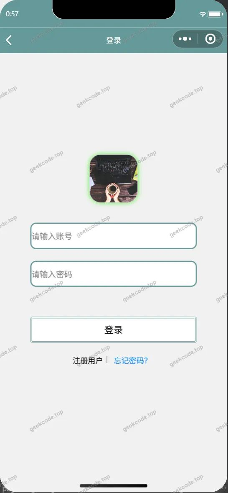</a><figcaption>小程序-登录</figcaption></figure>
<figure><a href="https://geekcode.top/archives/%E5%8C%BB%E9%99%A2%E6%A0%B8%E9%85%B8%E6%A3%80%E6%B5%8B%E9%A2%84%E7%BA%A6%E6%8C%82%E5%8F%B7%E5%BE%AE%E4%BF%A1%E5%B0%8F%E7%A8%8B%E5%BA%8F-%E8%AE%BA%E6%96%87?utm_source=github" title="查看完整源码">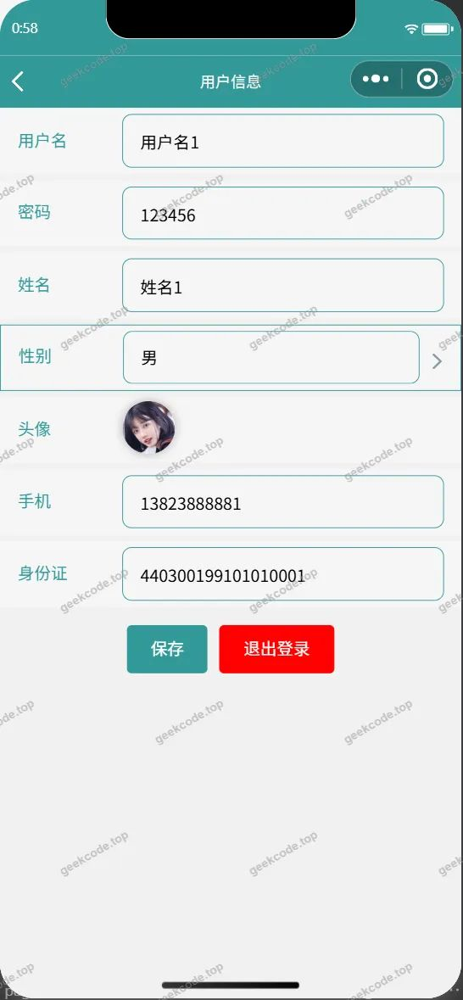</a><figcaption>小程序-个人信息</figcaption></figure>
<figure><figcaption>小程序-公告信息</figcaption></figure>
<figure><figcaption>小程序-核酸报告列表</figcaption></figure>
<figure><figcaption>小程序-核酸报告详情</figcaption></figure>
<figure><figcaption>小程序-核酸检测</figcaption></figure>
<figure><figcaption>小程序-核酸检测详情</figcaption></figure>
<figure><figcaption>小程序-核酸预约列表</figcaption></figure>
<figure><figcaption>小程序-核酸预约详情</figcaption></figure>
<figure><figcaption>小程序-首页</figcaption></figure>
<figure><a href="https://geekcode.top/archives/%E5%8C%BB%E9%99%A2%E6%A0%B8%E9%85%B8%E6%A3%80%E6%B5%8B%E9%A2%84%E7%BA%A6%E6%8C%82%E5%8F%B7%E5%BE%AE%E4%BF%A1%E5%B0%8F%E7%A8%8B%E5%BA%8F-%E8%AE%BA%E6%96%87?utm_source=github" title="查看完整源码">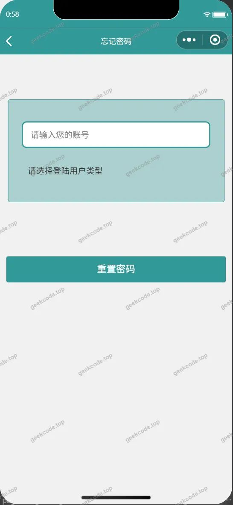</a><figcaption>小程序-忘记密码</figcaption></figure>
<figure><a href="https://geekcode.top/archives/%E5%8C%BB%E9%99%A2%E6%A0%B8%E9%85%B8%E6%A3%80%E6%B5%8B%E9%A2%84%E7%BA%A6%E6%8C%82%E5%8F%B7%E5%BE%AE%E4%BF%A1%E5%B0%8F%E7%A8%8B%E5%BA%8F-%E8%AE%BA%E6%96%87?utm_source=github" title="查看完整源码">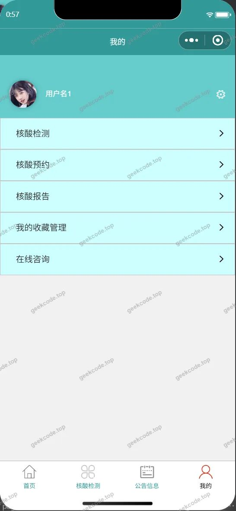</a><figcaption>小程序-我的</figcaption></figure>
<figure><figcaption>小程序-我的收藏列表</figcaption></figure>
<figure><figcaption>小程序-在线客服</figcaption></figure>
<figure><a href="https://geekcode.top/archives/%E5%8C%BB%E9%99%A2%E6%A0%B8%E9%85%B8%E6%A3%80%E6%B5%8B%E9%A2%84%E7%BA%A6%E6%8C%82%E5%8F%B7%E5%BE%AE%E4%BF%A1%E5%B0%8F%E7%A8%8B%E5%BA%8F-%E8%AE%BA%E6%96%87?utm_source=github" title="查看完整源码">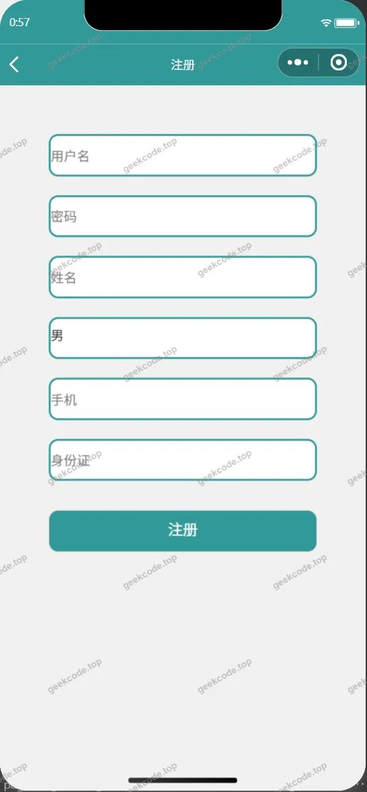</a><figcaption>小程序-注册</figcaption></figure>
<figure><a href="https://geekcode.top/archives/%E5%8C%BB%E9%99%A2%E6%A0%B8%E9%85%B8%E6%A3%80%E6%B5%8B%E9%A2%84%E7%BA%A6%E6%8C%82%E5%8F%B7%E5%BE%AE%E4%BF%A1%E5%B0%8F%E7%A8%8B%E5%BA%8F-%E8%AE%BA%E6%96%87?utm_source=github" title="查看完整源码">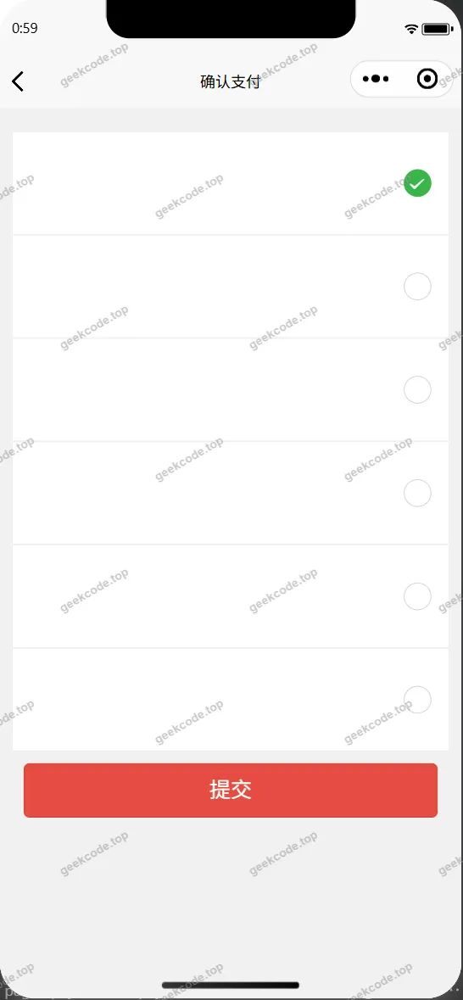</a><figcaption>小程序-payconfirm</figcaption></figure>

<h3>微信小程序管理端</h3>

<figure><a href="https://geekcode.top/archives/%E5%8C%BB%E9%99%A2%E6%A0%B8%E9%85%B8%E6%A3%80%E6%B5%8B%E9%A2%84%E7%BA%A6%E6%8C%82%E5%8F%B7%E5%BE%AE%E4%BF%A1%E5%B0%8F%E7%A8%8B%E5%BA%8F-%E8%AE%BA%E6%96%87?utm_source=github" title="查看完整源码">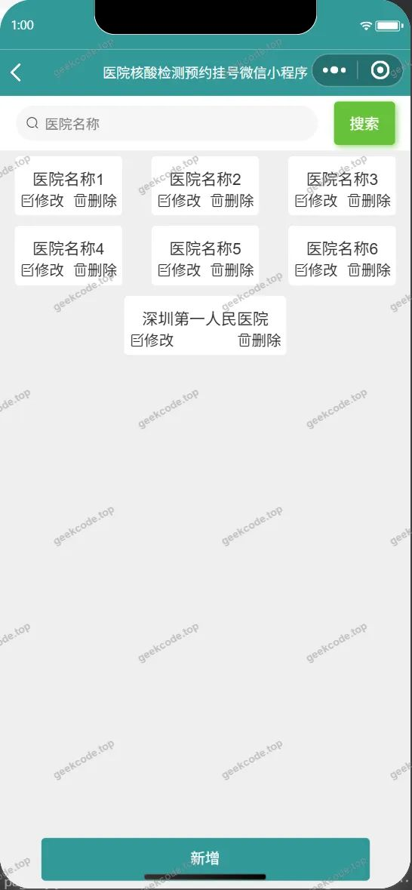</a><figcaption>小程序-管理端-医院信息列表</figcaption></figure>
<figure><figcaption>小程序-管理端-医院信息详情</figcaption></figure>
<figure><figcaption>小程序-管理端-用户列表</figcaption></figure>
<figure><a href="https://geekcode.top/archives/%E5%8C%BB%E9%99%A2%E6%A0%B8%E9%85%B8%E6%A3%80%E6%B5%8B%E9%A2%84%E7%BA%A6%E6%8C%82%E5%8F%B7%E5%BE%AE%E4%BF%A1%E5%B0%8F%E7%A8%8B%E5%BA%8F-%E8%AE%BA%E6%96%87?utm_source=github" title="查看完整源码">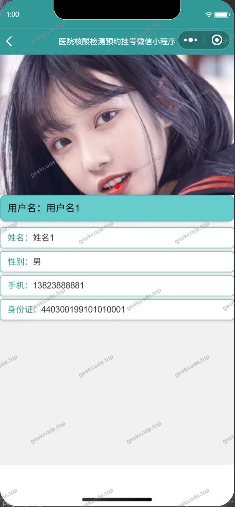</a><figcaption>小程序-管理端-用户详情</figcaption></figure>
<figure><a href="https://geekcode.top/archives/%E5%8C%BB%E9%99%A2%E6%A0%B8%E9%85%B8%E6%A3%80%E6%B5%8B%E9%A2%84%E7%BA%A6%E6%8C%82%E5%8F%B7%E5%BE%AE%E4%BF%A1%E5%B0%8F%E7%A8%8B%E5%BA%8F-%E8%AE%BA%E6%96%87?utm_source=github" title="查看完整源码">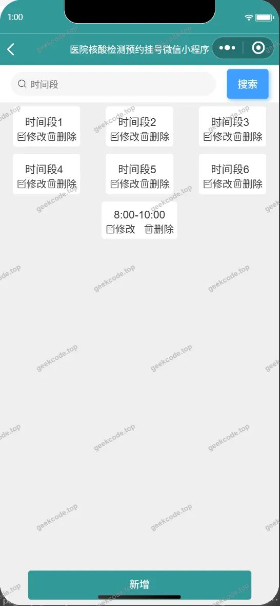</a><figcaption>小程序-管理端-预约时间段列表</figcaption></figure>

<h3>后台管理端</h3>
<h4>后台-登录页</h4>

<h4>后台-公告信息</h4>

<a href="https://geekcode.top/archives/%E5%8C%BB%E9%99%A2%E6%A0%B8%E9%85%B8%E6%A3%80%E6%B5%8B%E9%A2%84%E7%BA%A6%E6%8C%82%E5%8F%B7%E5%BE%AE%E4%BF%A1%E5%B0%8F%E7%A8%8B%E5%BA%8F-%E8%AE%BA%E6%96%87?utm_source=github" title="查看完整源码">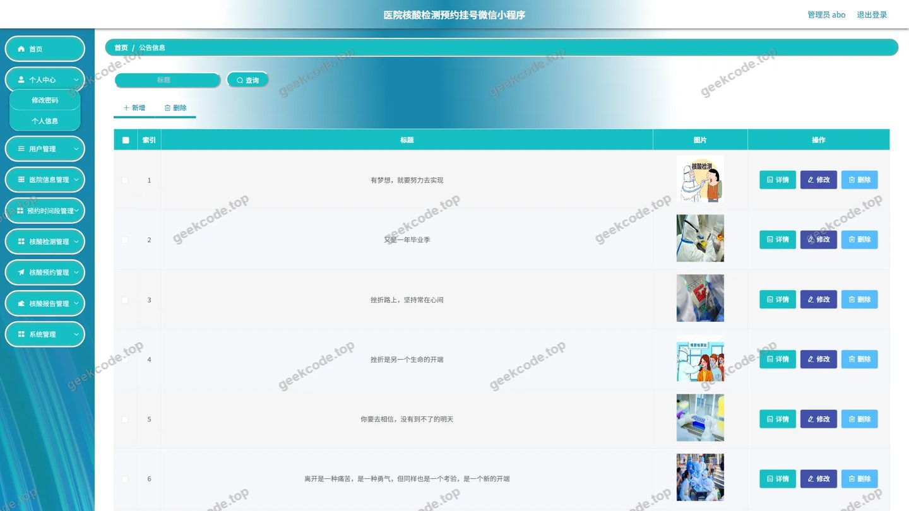</a>

<h4>后台-核酸检测</h4>

<a href="https://geekcode.top/archives/%E5%8C%BB%E9%99%A2%E6%A0%B8%E9%85%B8%E6%A3%80%E6%B5%8B%E9%A2%84%E7%BA%A6%E6%8C%82%E5%8F%B7%E5%BE%AE%E4%BF%A1%E5%B0%8F%E7%A8%8B%E5%BA%8F-%E8%AE%BA%E6%96%87?utm_source=github" title="查看完整源码">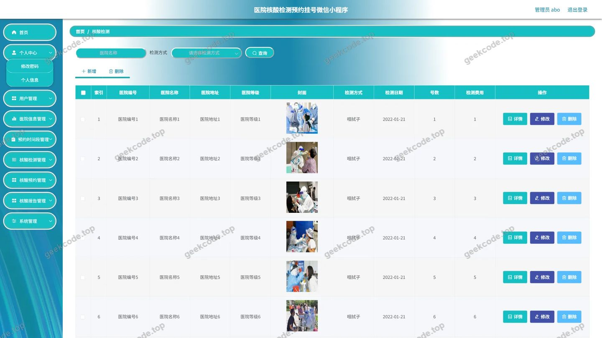</a>

<h4>后台首页</h4>

<h4>后台-医院信息</h4>

<a href="https://geekcode.top/archives/%E5%8C%BB%E9%99%A2%E6%A0%B8%E9%85%B8%E6%A3%80%E6%B5%8B%E9%A2%84%E7%BA%A6%E6%8C%82%E5%8F%B7%E5%BE%AE%E4%BF%A1%E5%B0%8F%E7%A8%8B%E5%BA%8F-%E8%AE%BA%E6%96%87?utm_source=github" title="查看完整源码">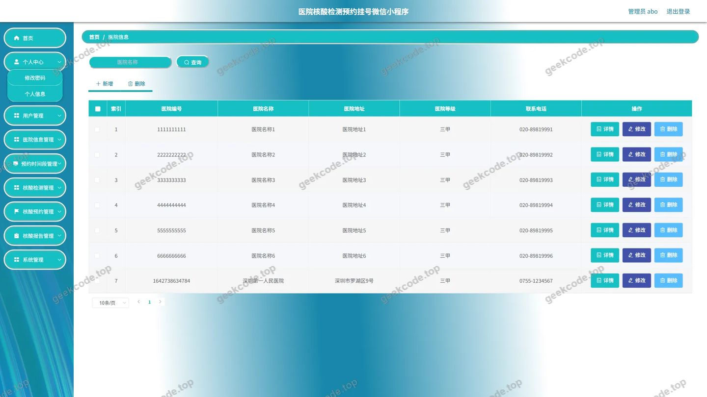</a>

<h4>后台-用户</h4>

<a href="https://geekcode.top/archives/%E5%8C%BB%E9%99%A2%E6%A0%B8%E9%85%B8%E6%A3%80%E6%B5%8B%E9%A2%84%E7%BA%A6%E6%8C%82%E5%8F%B7%E5%BE%AE%E4%BF%A1%E5%B0%8F%E7%A8%8B%E5%BA%8F-%E8%AE%BA%E6%96%87?utm_source=github" title="查看完整源码">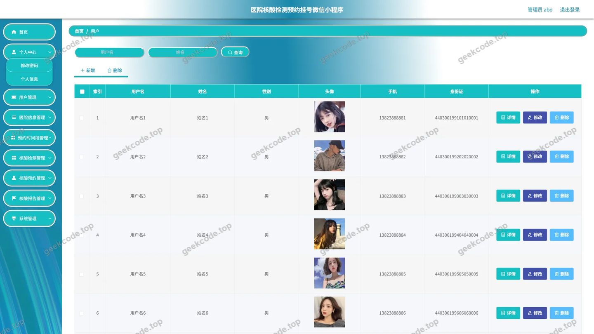</a>

<h4>后台-预约时间段</h4>

<h4>后台-在线咨询</h4>

<a href="https://geekcode.top/archives/%E5%8C%BB%E9%99%A2%E6%A0%B8%E9%85%B8%E6%A3%80%E6%B5%8B%E9%A2%84%E7%BA%A6%E6%8C%82%E5%8F%B7%E5%BE%AE%E4%BF%A1%E5%B0%8F%E7%A8%8B%E5%BA%8F-%E8%AE%BA%E6%96%87?utm_source=github" title="查看完整源码">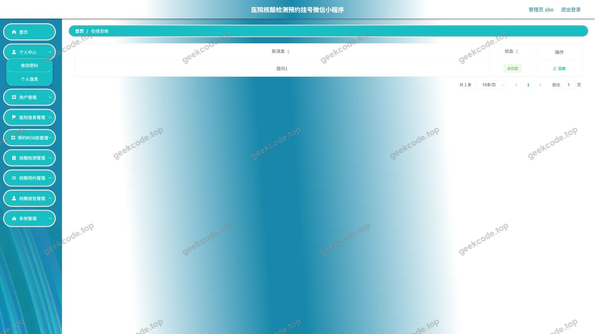</a>

---

## 获取完整源码

| 项目 | 说明 |
| --- | --- |
| 项目名 | 医院核酸检测预约挂号微信小程序--论文 |
| 运行截图 | 本文 30 张（站点带水印原图，仓库 `images/` 目录） |
| 完整源码 | [https://geekcode.top/archives/%E5%8C%BB%E9%99%A2%E6%A0%B8%E9%85%B8%E6%A3%80%E6%B5%8B%E9%A2%84%E7%BA%A6%E6%8C%82%E5%8F%B7%E5%BE%AE%E4%BF%A1%E5%B0%8F%E7%A8%8B%E5%BA%8F-%E8%AE%BA%E6%96%87?utm_source=github](https://geekcode.top/archives/%E5%8C%BB%E9%99%A2%E6%A0%B8%E9%85%B8%E6%A3%80%E6%B5%8B%E9%A2%84%E7%BA%A6%E6%8C%82%E5%8F%B7%E5%BE%AE%E4%BF%A1%E5%B0%8F%E7%A8%8B%E5%BA%8F-%E8%AE%BA%E6%96%87?utm_source=github) |
| 咨询微信 | **ir9372**（备注：jingpin-yuanma） |
| 更多项目 | [极客代码 geekcode.top](https://geekcode.top/?utm_source=github) |

> 需要源码、部署、改配置、跑不起来等问题，加微信 ir9372 沟通，说明项目名即可。
